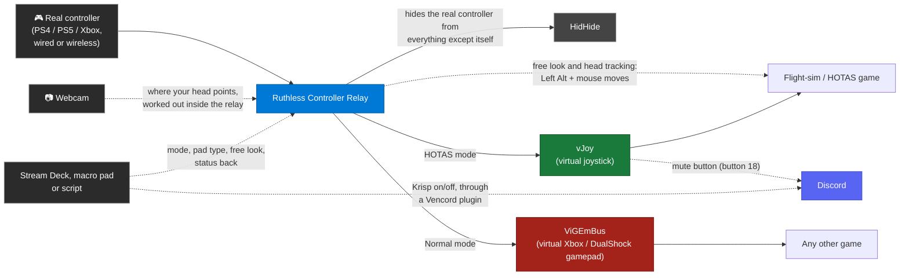
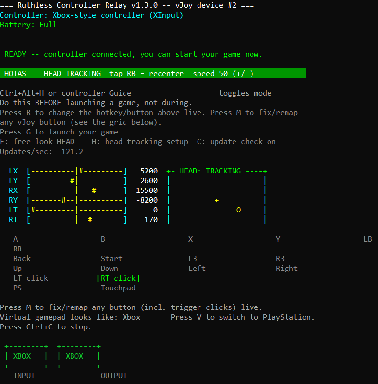
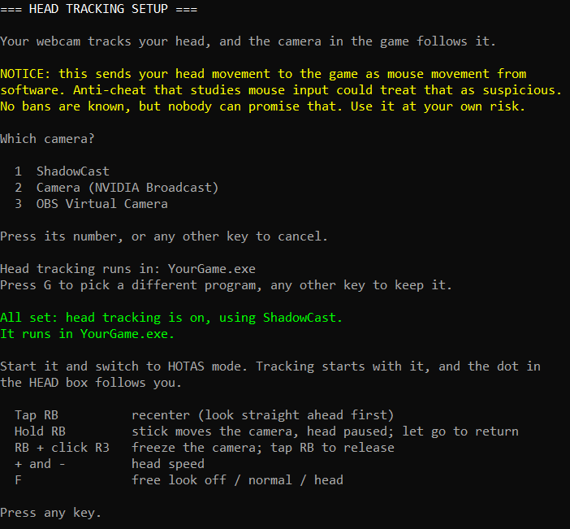
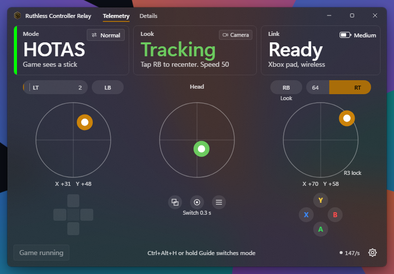

<div align="center">

# Ruthless Controller Relay

**Use a PlayStation or Xbox controller as a real HOTAS-style joystick — or a clean, reliable regular gamepad — in any Windows game.**

Full rumble, lightbar/LED color, and battery reporting, wherever the hardware and connection type genuinely allow it. Optional webcam head tracking and Stream Deck control.

[](#)
[](src/hotas_relay.c)
[](https://ziglang.org/)
[](LICENSE)
[](../../releases/latest)

**[⬇️ Download the latest version](../../releases/latest)** · [Older versions](#versions-and-whats-different)

[FAQ](docs/FAQ.md) · [How it works](#how-it-works) · [What's new](#whats-new) · [Versions](#versions-and-whats-different) · [Quick start](#quick-start) · [Controls](#controls) · [Free look](#free-look-hotas-mode) · [Head tracking](docs/HEAD_TRACKING.md) · [Updates](#updates) · [Stream Deck](#stream-deck-and-macro-pad-control) · [Compatibility](#what-works-and-what-doesnt) · [Is this safe?](#is-this-safe-to-run) · [Building](#building-from-source) · [Credits](#credits)

</div>

---

> **⚠️ Using Steam? Disable Steam Input for the game first** — it bypasses this software entirely otherwise. Details: [Known Limitations](docs/KNOWN_LIMITATIONS.md#steam-input-must-be-disabled).

> **⚠️ On v1.0.0? Please [update](../../releases/latest).** If your controller falls asleep in that version, your real controller can become visible to the game. [More below](#updates).

---

## The problem this solves

Flight sims, space sims, and other HOTAS-style games bind their controls to a real **joystick** device — a flight stick, a throttle, a yoke. A gamepad isn't one of those, and Windows treats "gamepad" and "joystick" as genuinely different device classes, not just a labeling difference. If you don't own a real HOTAS setup and want to fly with a PS4/PS5 or Xbox controller instead, there was no clean, single tool that could present it as a virtual joystick to that one flight sim, while still behaving like a normal controller everywhere else — switchable live, with no reboot and no unplug/replug.

## How it works

This tool sits between your real controller and every game on the system. Solid lines are always on, and dotted lines are the optional parts:



Once you pick a mode, only one virtual device is live — the other is present but muted, never added or removed on the fly, since neither HidHide nor games handle live device changes reliably. Rumble, LED color, and battery level flow the other direction: read back from the virtual device and forwarded to the real controller, wherever the connection type allows it (see [compatibility](#what-works-and-what-doesnt) below).

<p align="center"></p>

<p align="center"><sub>The live dashboard — real-time axis/button state, current mode, and what the game sees vs. what's actually plugged in.</sub></p>

All the driver work is done by other people's projects: **[vJoy](https://github.com/shauleiz/vJoy)**, **[ViGEmBus](https://github.com/nefarius/ViGEmBus)** and **[HidHide](https://github.com/nefarius/HidHide)**. Head tracking is a C port of **[opentrack](https://github.com/opentrack/opentrack)**'s tracker, running on Microsoft's **[ONNX Runtime](https://github.com/microsoft/onnxruntime)**. See [Credits](#credits) for who made what and why each one is used.

## What's new

- **Sticks dead in HOTAS mode? Fixed in v1.4.1.** The relay could end up listening to the wrong device. There's a new tool in the zip, `JoystickDoctor.exe`, that lists every joystick Windows knows about and clears old leftovers. See the [FAQ](docs/FAQ.md).

<p align="center"></p>

- **🎯 [Head tracking](docs/HEAD_TRACKING.md).** Turn your head and the camera follows, using any webcam. Press `H` in the relay window to set it up. Everything it needs comes in the download. Off until you turn it on.
- **A dot shows where you're pointing,** right in the relay window, with no extra windows.
- **`RB` in head tracking:** tap to recenter; hold to look around with the stick, even behind you.
- **Automatic update check.** The relay tells you when there's a new version and asks before installing it. Press `C` to turn it off.
- **Head tracking is built into the relay (v1.4.0).** No separate program, window or tray icon, and nothing to install. The camera is only on while your game is running in HOTAS mode. Virtual cameras like OBS and NVIDIA Broadcast work.
- **Fresh-PC fix (v1.3.1).** On a PC that got HidHide from the relay rather than from HidHide's own installer, the real controller could stay visible to games. Fixed. Everyone on an older version should update.

## Versions and what's different

Every published version stays up on the **[Releases page](../../releases)**, so you can always go back to an older one. Each has its own notes and download.

| Version | Released | What's different |
|---|---|---|
| **[v1.4.1](../../releases/tag/v1.4.1)** (latest) | 2026-11-01 | Fixes the relay listening to the wrong device, which left the sticks dead in HOTAS mode. Adds JoystickDoctor, a tool that lists every joystick and clears old leftovers |
| **[v1.4.0](../../releases/tag/v1.4.0)** | 2026-11-01 | Head tracking is built into the relay, written in C, with no opentrack: no extra program, window or tray icon. The camera is only on while your game runs in HOTAS mode, virtual cameras work, and the zip drops to about 18 MB. opentrack's window for tuning, and TrackIR-style hardware, are gone |
| **[v1.3.1](../../releases/tag/v1.3.1)** | 2026-11-01 | Head tracking needs no install: a trimmed opentrack runs from a folder beside the relay. Fixes hiding the real controller on a fresh PC. The SAFE build no longer shows keys it doesn't have. Rewritten home page and cheat sheet |
| **[v1.3.0](../../releases/tag/v1.3.0)** | 2026-11-01 | Head tracking with any webcam, the HEAD box, a GitHub update check you can turn off, and opening the relay twice now brings up the first one. Comes with opentrack's full installer, so the zip is about 190 MB. Has the fresh-PC bug that v1.3.1 fixes |
| **[v1.2.0](../../releases/tag/v1.2.0)** | 2026-10-05 | Stream Deck, macro-pad and script control. A controller button for Discord mute in Normal mode |
| **[v1.1.0](../../releases/tag/v1.1.0)** | 2026-10-02 | Free look in HOTAS mode: hold RB to look, RB + R3 to lock. Steadier virtual joystick. A small stick dead zone in Normal mode |
| **[v1.0.1](../../releases/tag/v1.0.1)** | 2026-10-01 | Fixes the controller sleep and reconnect bug. Shows the version number in the window |
| **[v1.0.0](../../releases/tag/v1.0.0)** | 2026-09-09 | First public release. Outdated: it has the sleep bug that v1.0.1 fixes |

Every change in detail: **[CHANGELOG.md](CHANGELOG.md)**.

## Quick start

**Sticks doing nothing?** See the **[FAQ](docs/FAQ.md)**.

1. Download the [latest release](../../releases/latest) and unzip it, or [build it yourself](#building-from-source). The zip has everything: the relay, its drivers, and what head tracking needs.
2. **Using Steam?** [Disable Steam Input](docs/KNOWN_LIMITATIONS.md#steam-input-must-be-disabled) for the game first.
3. Run `RuthlessControllerRelay.exe`. On first run it self-installs vJoy/HidHide/ViGEmBus if they aren't already present (see [how and why](docs/DEVELOPMENT_JOURNEY.md#core-architecture)).
4. Connect a controller — the dashboard shows what it detected and what it's currently presenting to games.
5. Press `Ctrl+Alt+H` (or the controller button shown on the dashboard) to switch between **HOTAS mode** and **Normal mode**.
6. In HOTAS mode, bind your game's flight controls to the joystick it now sees.

For a plain-English "is this working right now" guide with no jargon, see the **[Compatibility Cheat Sheet (PDF)](docs/Controller_Compatibility_Cheat_Sheet.pdf)**. It's in the zip too.

## Controls

| Key | Does |
|---|---|
| `Ctrl+Alt+H` <br/><sub>(or the controller button shown on-screen)</sub> | Switch between HOTAS mode and Normal mode |
| `V` | Flip the virtual output between PlayStation-style and Xbox-style |
| `R` | Change the hotkey/button combo for the mode switch above |
| `M` | Remap a button |
| `G` | Pick your game's `.exe`, then launch it |
| `F` | Free look: off, normal or head tracking |
| `H` | Set up [head tracking](docs/HEAD_TRACKING.md), or change its camera or game |
| `+` / `-` | Free-look or head-tracking speed (saved automatically) |
| `U` | Update, when the title line says a new version is out |
| `C` | Turn the automatic update check on or off |
| Hold `RB` <br/><sub>(HOTAS mode)</sub> | Free look: the right stick's left/right turns the camera. Let go and the view snaps back. See [Free look](#free-look-hotas-mode) |
| `RB` + click `R3` | Lock the camera where it's looking; tap `RB` or click `R3` to unlock |
| Tap `RB` <br/><sub>(head tracking)</sub> | Recenter. Hold it to steer with the stick instead. See [Head tracking](docs/HEAD_TRACKING.md#controls) |

Letter keys only work with the relay window focused and a controller connected. `Ctrl+Alt+H` works from anywhere. On a PlayStation controller, `RB` is `R1`.

### The mode-switch button

**The controller-side default depends on what's plugged in the first time you ever run it**: a PlayStation controller defaults to the PS button alone, and an Xbox controller defaults to the **Guide/Xbox-logo button** — confirmed working on real hardware, including through the official Xbox Wireless Adapter dongle. Neither button ever reaches whatever the game sees, so it can't collide with anything the game itself does. This is decided once, the very first time a controller connects on a fresh install, and never overwritten afterward — change it any time with `R`, or by hand-editing `button=` in `ruthless_controller_relay.ini` (e.g. `button=back+start` for the classic combo instead). Full story, including why the newer Share button doesn't get the same treatment, in [Known Limitations](docs/KNOWN_LIMITATIONS.md#the-xboxguide-button--solved-and-confirmed-on-real-hardware).

Two separate Steam settings can each independently break this — see [Known Limitations](docs/KNOWN_LIMITATIONS.md#steam-input-must-be-disabled) if you use Steam.

When the PS button (or touchpad) is configured as the toggle specifically, it's deliberately never also forwarded as a normal vJoy button at the same time — so it can't do double duty as both a mode-switch and a bound joystick action. (This doesn't apply to standard buttons like Back+Start, which keep working as ordinary vJoy buttons even while also serving as the toggle combo — unchanged, long-standing behavior.)

## Free look (HOTAS mode)

Added in v1.1.0. While you hold **RB** in HOTAS mode:
- the right stick's **left/right turns the camera** instead of rolling the aircraft,
- **up/down keeps flying pitch**, and the left stick works as normal, so you can keep making corrections while you look around,
- **letting go** snaps the camera back, and the stick flies again instantly, wherever it's pointing.

**Lock:** hold RB and click **R3** to keep the camera parked where it is after you let go. Tap **RB** or click **R3** to unlock. The dashboard banner turns yellow while you're looking and magenta while the camera is locked.

**Bind the snap-back once:** in your game's controls, bind free look reset, if it has one, to RB's joystick button. That's button 6, which some games show as button 5. Letting go of RB presses it for a moment, and that's what snaps the camera back.

How it works: the relay holds **Left Alt** and turns the stick into **mouse movement**, which drives the game's own Alt + mouse free look. That only fits games where holding Left Alt and moving the mouse is free look. For any other game, press `F` until free look is off, or set `freelook=off` in `ruthless_controller_relay.ini`, and RB goes back to being an ordinary button. The speed lives in the same file as `freelook_speed=`, or change it live with `+` / `-`.

This is software-generated keyboard and mouse input, the same kind of stick-to-mouse remap DS4Windows and Steam Input do. Left Alt is always released when you let go, switch modes, disconnect, or close the relay, including after a crash.

## Optional features

Everything here is off until you turn it on, except the update check, which you can turn off.

### Head tracking

Added in v1.3.0. Turn your head and the camera follows, with both hands still on the sticks. Press **`H`** in the relay window, pick your webcam and your game, and that's the whole setup. A dot in the relay window shows where you're pointing.

<p align="center"></p>

It's built into the relay, so there's nothing to install and no other program or window. It opens your camera only while free look is set to head, you're in HOTAS mode and your game is running, and lets go of it as soon as any of that stops.

It only moves the mouse while you're in HOTAS mode and the game you picked has the mouse, so it leaves your desktop, other programs and in-game menus alone.

**Anti-cheat notice:** this sends your head movement to the game as software mouse movement, constantly, and some anti-cheat studies mouse input. One player using a head tracker has reported a ban for hacking, and the game studio's CEO said its detection may have seen it as inhuman mouse movement. There's no official rule or outcome yet, so nobody can promise it's safe. Use it at your own risk.

Full guide, including other webcams, other games and troubleshooting: **[docs/HEAD_TRACKING.md](docs/HEAD_TRACKING.md)**.

### Updates

The relay asks GitHub for the latest version number once each time it starts. If there's a newer one, the title line says so and **`U`** offers to install it. It always asks first, and it keeps your settings. Nothing is downloaded unless you say yes. The relay closes when the update is done, so close your game first. `U` needs a controller connected.

Don't want the check? Press **`C`**, or set `update_check=off` in `ruthless_controller_relay.ini`. The window shows whether it's on. The SAFE build has no update check.

Versions before v1.3.0 can't do this, so update those by hand once. To go back to an older version, see [Versions](#versions-and-whats-different).

**Still on v1.0.0?** The version is shown at the top of the relay window, and v1.0.0 shows no number there. In that version, if your controller turns off or falls asleep while the relay is running, the relay can lock onto its own virtual controller. Input stops, your real controller can become visible to the game, and the only fix is restarting both. [What went wrong](docs/DEVELOPMENT_JOURNEY.md#a-sleeping-controller-made-the-relay-read-its-own-virtual-pad-fixed-in-v101).

### Stream Deck and macro-pad control

Added in v1.2.0. Set `control_pipe=on` in `ruthless_controller_relay.ini` and a Stream Deck, any macro pad, or a script can switch HOTAS/Normal mode, flip the virtual pad between Xbox and PlayStation, switch free look (off, normal, head tracking), read the battery and live status, and close the relay. Unlike keyboard shortcuts, it keeps working while an administrator game has focus.

- **No plugin needed:** the included `RelayControl.exe` sends one command (`RelayControl.exe mode toggle`). Point a Stream Deck **System > Open** button at a shortcut to it.
- **Plugin authors:** it's a tiny local text protocol, one command per connection.

Local only, and the controller path isn't touched. Full guide: **[docs/STREAM_DECK.md](docs/STREAM_DECK.md)**.

### Discord mute button in Normal mode

Added in v1.2.0. Discord's keybinds can't see the virtual Xbox pad, so in Normal mode there was no controller button Discord could use for its mute. With `discord_button=dpad_down`, pressing D-pad down in Normal mode also presses an otherwise unused virtual-joystick button (button 18). Bind Discord's **Toggle Mute** to it, and a tap flips your mute while you play. HOTAS mode is unchanged. Setup and notes: **[docs/STREAM_DECK.md § Discord button](docs/STREAM_DECK.md#discord-button-in-normal-xbox-mode)**.

### Discord's noise filter from a Stream Deck

Separate from the relay, and the relay doesn't need it. A small plugin for the [Vencord](https://github.com/Vendicated/Vencord) client mod lets a Stream Deck key or a script switch Discord's Krisp noise filter on and off in the background, with no window popping up. Client mods are against Discord's terms, so read the notice first. Guide: **[docs/STREAM_DECK.md § Krisp](docs/STREAM_DECK.md#discords-noise-filter-from-a-stream-deck-vencord)**. The plugin is in [extras/vencord-bridge](extras/vencord-bridge).

## Sneak peek: 2.0

The relay is getting a real window. It lives in the taskbar and shows live sticks, buttons and head tracking on one tab, with the settings in a popup. The console stays, exactly as it is, one click away.

<p align="center"><a href="https://spongebobmoviept-lab.github.io/RuthlessControllerRelay/"></a></p>

**[Click around in it here.](https://spongebobmoviept-lab.github.io/RuthlessControllerRelay/)** It's a mock-up: the pad and head movement are fake, and there's nothing to download yet. The real app is being built on the [`2.0-alpha` branch](../../tree/2.0-alpha).

## What's coming next

- **Joystick force feedback** (DualSense HD haptics) is an open idea with no date. See [issue #10](https://github.com/spongebobmoviept-lab/RuthlessControllerRelay/issues/10).
- Ideas and requests are welcome in [Issues](../../issues).

## What works and what doesn't

Full plain-English matrix, connection by connection: **[Controller Compatibility Cheat Sheet (PDF)](docs/Controller_Compatibility_Cheat_Sheet.pdf)**.

| Controller | Connection | Input | Rumble / LED / Battery |
|---|---|:---:|:---:|
| PlayStation (DS4 / DualSense) | USB cable | ✅ | ✅ |
| PlayStation (DS4 / DualSense) | Bluetooth | ✅ | ❌ — [see why](docs/KNOWN_LIMITATIONS.md#bluetooth-playstation-controller-rumble-and-led-output) |
| Xbox | Wireless dongle | ✅ | ✅ |
| Xbox | USB cable | ✅ (normal play) | ⚠️ HOTAS mode unreliable — [see why](docs/KNOWN_LIMITATIONS.md#wired-xbox-controllers-cant-be-hidden-from-other-apps) |

Both limitations above are genuine Windows/hardware constraints, investigated in depth rather than assumed — the linked sections explain exactly why, and what was tried.

**HOTAS mode and force feedback:** flying with a HOTAS setup gets no vibration or force feedback from the sim itself. Normal-mode rumble is unaffected. See [what's coming next](#whats-coming-next).

## Is this safe to run?

Yes, for the overwhelming majority of games and use cases. vJoy/ViGEmBus/HidHide are Microsoft-signed, widely used (the same foundation [DS4Windows](https://github.com/Ryochan7/DS4Windows) runs on), and this contains no keyboard/mouse interception of any kind. A full `--uninstall` is built in.

- **Software mouse movement:** free look and head tracking, both optional, send it to the game. [Notice](docs/KNOWN_LIMITATIONS.md#free-look-and-head-tracking-send-software-input).
- **Kernel-level anti-cheat:** the one confirmed driver problem. Some competitive multiplayer games block driver-level tools like this regardless of intent. There's one confirmed case, not a general pattern. Full detail, including exactly what's confirmed vs. uncertain: **[Known Limitations § Anti-cheat](docs/KNOWN_LIMITATIONS.md#anti-cheat)**.
- **The internet:** the relay only goes online for the update check (`C` turns it off) and an update you approve, both to GitHub over HTTPS. Updates have no signature check of their own. They trust this GitHub repo, the same as downloading by hand.
- **Your webcam:** the picture stays inside the relay. It's never saved or sent anywhere, and the camera is only on while head tracking is running.

## Building from source

Compile the resource file first (embeds the UAC manifest + icon):
```sh
zig rc resources/hotas_relay.rc resources/hotas_relay_manifest.res
```

Then build:
```sh
zig cc -target x86_64-windows-gnu -O2 -Wall -Wextra \
    -I third_party -I third_party/vigem_client \
    -o RuthlessControllerRelay.exe \
    src/hotas_relay.c resources/hotas_relay_manifest.res \
    -ldinput8 -ldxguid -lole32 -loleaut32 -lcomdlg32 -ladvapi32 -lshell32 -lsetupapi -lnewdev -lhid -lcfgmgr32 -lwinhttp
```

Copy `third_party/vigem_client/ViGEmClient.dll` next to the built exe, and copy `third_party/drivers` beside it as a folder named `drivers`. For a fresh PC, add `HidHideCLI.exe` to `drivers/hidhide`: it isn't in this repo, but it's in the release zip and HidHide's own install. For head tracking, copy the `head_tracker` folder from the release zip there too. See [docs/DEVELOPMENT_JOURNEY.md](docs/DEVELOPMENT_JOURNEY.md) for exactly why the driver payload is structured this way instead of shelling out to each vendor's own GUI installer.

`RelayControl.exe`, the small helper for Stream Deck buttons and scripts, is a separate program:
```sh
zig cc -target x86_64-windows-gnu -O2 -Wall -Wextra -Wl,--subsystem,windows -s \
    -o RelayControl.exe src/relay_control.c
```

`JoystickDoctor.exe`, the tool that lists joysticks and clears old leftovers, is one more:
```sh
zig cc -target x86_64-windows-gnu -O2 -Wall -Wextra -s -o JoystickDoctor.exe src/joystick_doctor.c     -ldinput8 -ldxguid -lole32 -lsetupapi -lcfgmgr32 -ladvapi32 -lshell32 -luser32
```

Add `-DSAFE_MODE_NO_EXTRAS` to build a stripped-down fallback variant with no rumble, LED, battery, head tracking, update check or Stream Deck control compiled in — a minimal, maximally conservative build for if the full one ever misbehaves on a specific machine.

Built and tested with **[zig cc](https://ziglang.org/)**, a self-contained cross-compiling C toolchain — no Visual Studio install required, even on the build machine.

<details>
<summary><b>Why does this need administrator rights?</b></summary>

<br>

The exe manages the lifecycle of a real kernel-mode virtual device (vJoy) that's created fresh on launch and fully torn down on exit, and it registers/hides devices through HidHide. Both need administrator rights on Windows, in both directions — it requests elevation on every launch, with no way around it. See [docs/DEVELOPMENT_JOURNEY.md § vJoy devices silently accumulating](docs/DEVELOPMENT_JOURNEY.md#vjoy-devices-silently-accumulating-across-sessions) for the actual trade-off this was weighed against (a persistent idle device vs. one UAC prompt per launch) and why it was decided this way.

</details>

## The development story

This project went through real, sometimes serious, failures on the way here — including one that briefly bricked a keyboard and mouse system-wide. Every one of them is written up in full, including the wrong turns, in **[docs/DEVELOPMENT_JOURNEY.md](docs/DEVELOPMENT_JOURNEY.md)** — not as a changelog, but as a guide so nobody building on this has to rediscover the same holes the hard way.

## Credits

This project is a thin layer of glue on top of other people's engineering. They did the hard parts, and none of this works without them. Here's who made each piece and why it's the one used.

### Included in the download

| Project | Made by | What it does here | Why this one |
|---|---|---|---|
| **[vJoy](https://github.com/shauleiz/vJoy)** | Shaul Eizikovich | The virtual joystick HOTAS mode is built on | Games that bind a joystick need a real joystick device. vJoy is the long-standing free way to make one, and flight-sim players have relied on it for years |
| **[ViGEmBus](https://github.com/nefarius/ViGEmBus)** / **[ViGEmClient](https://github.com/nefarius/ViGEmClient)** | Benjamin Höglinger-Stelzer ([Nefarius](https://nefarius.at/)) | The virtual Xbox or DualShock pad in Normal mode | Games accept it as a real pad, and DS4Windows runs on the same foundation. Its repo is archived now, but the signed driver still works |
| **[HidHide](https://github.com/nefarius/HidHide)** | Eric Korff de Gidts, Benjamin Höglinger-Stelzer (Nefarius) | Hides the real controller, so games only ever see one device | Without it, a game sees the real and virtual controllers together and gets double input. It hides the real one from everything except the relay, with nothing to unplug |
| **[opentrack](https://github.com/opentrack/opentrack)** | Stanislaw Halik and contributors | The head tracking method. Its code was ported to C for this project | Free, open source, and works with an ordinary webcam. Porting it, rather than running it, means no extra program, window or settings left behind |
| **[NeuralNet tracker](https://github.com/opentrack/opentrack/tree/master/tracker-neuralnet)** | Michael Welter | Finds your head in the webcam picture. Ported to C, and its trained model files are in the zip | It only needs your face. No markers, clips or IR lights |
| **Accela filter** | Stanislaw Halik | Smooths the result. Ported to C | It steadies small shakes and keeps quick head turns quick |
| **[ONNX Runtime](https://github.com/microsoft/onnxruntime)** | Microsoft | Runs the tracker's neural network. Its DLL is in the zip | Fast on an ordinary CPU, with a plain C interface the relay can load directly |

### Used, but not in the download

| Project | Made by | What it does here | Why this one |
|---|---|---|---|
| **[zig cc](https://ziglang.org/)** | Andrew Kelley and the Zig contributors | Builds the relay from source | A whole C compiler in one download, with no Visual Studio needed, so anyone can rebuild this |
| **[Vencord](https://github.com/Vendicated/Vencord)** | Vendicated and contributors | Only for the [optional Krisp key](docs/STREAM_DECK.md#discords-noise-filter-from-a-stream-deck-vencord). You install it yourself | Its plugins can reach Discord's Krisp switch in the background. The earlier approach drove Discord's window, which popped up and took the keyboard. It's against Discord's terms, so read the notice first |
| **[DS4Windows](https://github.com/Ryochan7/DS4Windows)**, the Linux kernel's HID drivers, [psdevwiki](https://www.psdevwiki.com/ps4/DS4-BT), [Xidi](https://github.com/samuelgr/Xidi) | Their authors | Reference for how controllers report rumble, LED, battery and the Guide button | Real, working code and tests to learn from, rather than guessing. No code was copied |

Everything else is already in Windows: DirectShow reads the camera, and WinHTTP and `tar` do the update check.

Full license texts and copyright notices are in **[THIRD_PARTY_LICENSES.md](THIRD_PARTY_LICENSES.md)** — please keep them intact if you redistribute this. They deserve the credit for what actually makes the hard parts possible.

This project's own code was developed with AI assistance for much of the implementation, debugging, and research, directed and hardware-tested throughout by the project owner.

## License

This project's own source code ([src/hotas_relay.c](src/hotas_relay.c) and everything else outside `third_party/` and `extras/`) is licensed under the [MIT License](LICENSE). The bundled third-party drivers and libraries under `third_party/` keep their own original licenses — see [THIRD_PARTY_LICENSES.md](THIRD_PARTY_LICENSES.md). The optional Vencord plugin in `extras/vencord-bridge/` builds into Vencord, so it's GPL-3.0-or-later like Vencord itself.
