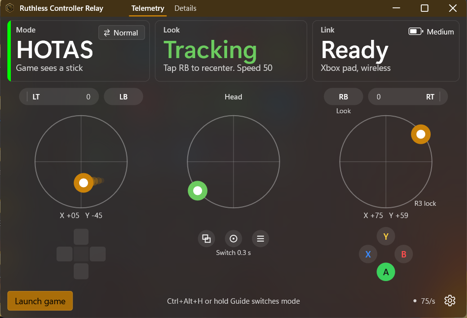
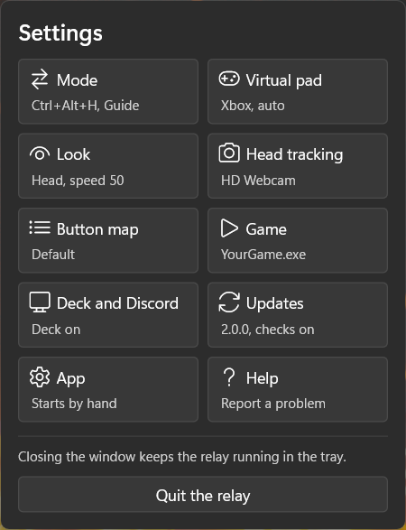
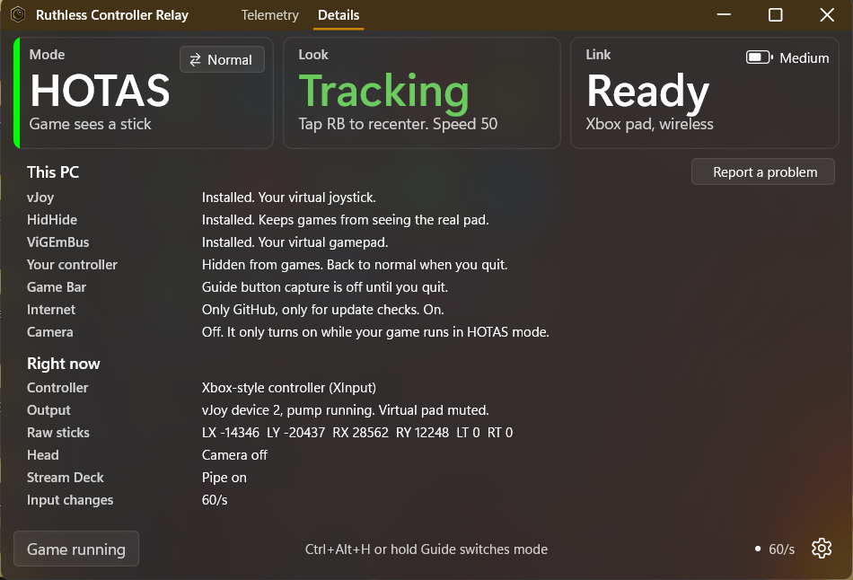
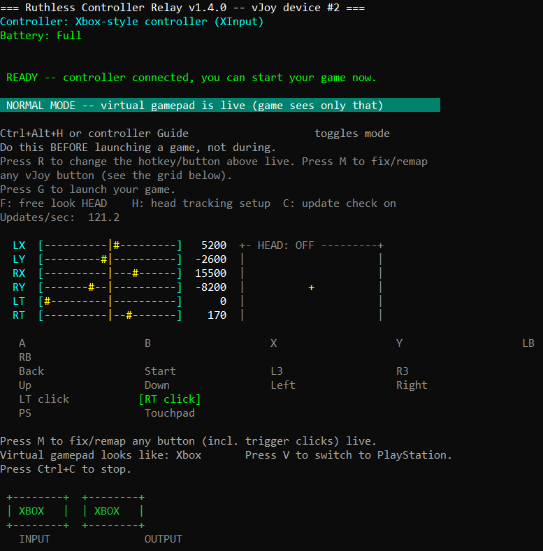
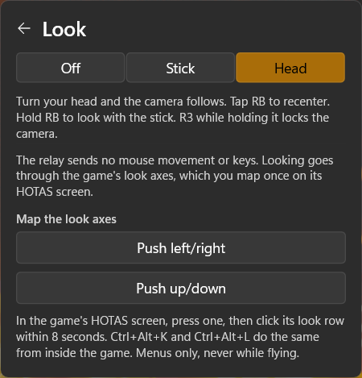
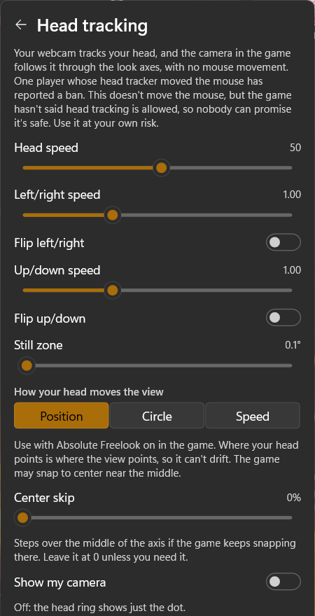
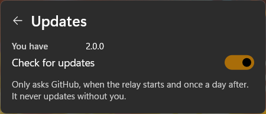
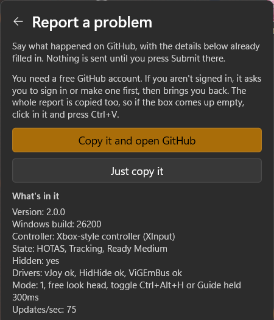
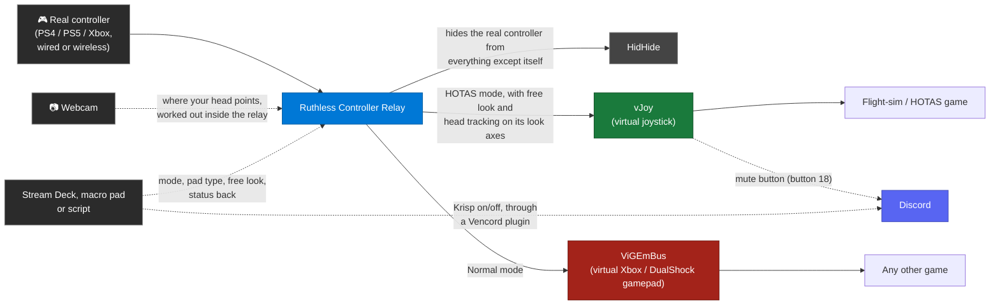

<div align="center">

# Ruthless Controller Relay

**Use a PlayStation or Xbox controller as a real HOTAS-style joystick, or a clean regular gamepad, in any Windows game.**

**No mouse or keyboard emulation. Gamepad to joystick, 1:1. No hacking, no cheats.** [Why that matters](#no-mouse-no-keys)

[](#)
[](src/hotas_relay.c)
[](https://ziglang.org/)
[](LICENSE)
[](../../releases/latest)

**[⬇️ Download the latest version](../../releases/latest)**

[Get started](#get-started) · [No mouse, no keys](#no-mouse-no-keys) · [The window](#the-window) · [Free look](#free-look-hotas-mode) · [Head tracking](#head-tracking) · [Updates](#updates) · [Report a bug](#report-a-bug) · [FAQ](docs/FAQ.md) · [What works](#what-works-and-what-doesnt) · [Versions](#versions)



</div>

---

> **⚠️ Using Steam?** Disable Steam Input for the game first, or it bypasses this software. [How](docs/KNOWN_LIMITATIONS.md#steam-input-must-be-disabled).

> **⚠️ Coming from 1.x?** Free look and head tracking moved off the mouse, so you have to [map the look axes](#map-the-look-axes-once) once in your game, or RB won't move the camera.

---

## What it does

Flight sims and other HOTAS games bind their controls to a **joystick**, and Windows treats a gamepad as a different kind of device. If you want to fly with a PS4, PS5 or Xbox controller, this makes it a joystick when you want one, and a normal pad the rest of the time. You switch with one key, with no reboot and no unplugging.

| Mode | What games see |
|---|---|
| **HOTAS** | A joystick. Bind your flight controls to it |
| **Normal** | A regular Xbox or PlayStation pad |

Your real controller is hidden from games the whole time the relay runs, so they only get input from one virtual device at a time, and it comes back when you quit. Rumble, light color and battery work wherever the hardware and connection allow it. [What works](#what-works-and-what-doesnt).

Everything else is optional: free look, webcam head tracking, Stream Deck control and a Discord mute button.

## No mouse, no keys

**There is no mouse or keyboard emulation in this program.** It's a gamepad to joystick converter: in HOTAS mode your sticks move joystick axes and your buttons press joystick buttons, 1:1, with no curve, smoothing or dead zone. No hacking, no cheats.

The one change is free look, which is on by default and easy to turn off. RB becomes the look button, and while you hold it, the right stick's left/right moves a look axis instead of roll, with a small dead zone. Set Look to Off and RB is an ordinary button again.

Versions 1.1.0 to 1.4.1 moved the mouse for free look and head tracking. One player whose head tracker moved the mouse has reported a ban for hacking, and the game studio's CEO said its detection may have seen it as inhuman mouse movement. So 2.0 takes the mouse out completely, even though the mouse felt better. We've done everything we can to lower the risk.

**Why we don't think it gets flagged as cheating:**

- **Nothing sends mouse or keyboard input.** The program has no `SendInput`, `mouse_event`, `keybd_event` or `SetCursorPos`, and no keyboard or mouse hooks. You don't have to take our word for it: search [`src/`](src) for those names, or search the `.exe` itself.
- **In HOTAS mode, the game only gets joystick input:** axes and buttons, the same as a real HOTAS. Looking around goes through the look axes the game itself offers on its HOTAS screen.
- **There's no mouse movement left to look inhuman.** That's what the report was about, and this makes none.
- **It adds nothing to how you play.** No aim help, no recoil control, no macros. Free look turns your stick into looking while you hold RB, and head tracking turns your head into two more joystick axes. The only things the relay does by itself are a short tap of RB's joystick button when you let go of RB, so the camera snaps back, and the 8-second axis push for mapping, which only runs in menus.
- **It stays out of the game.** It doesn't inject anything, read the game's memory or draw over it. It finds the game by name in Windows' process list, without opening it.

**No guarantees.** This is our reasoning, not a ruling. The game's developers haven't said head tracking is allowed, and nobody outside the studio knows exactly what their tools look for. A look axis following your head all the time still isn't what most players' input looks like. It's your account, so it's your call. With Look set to Off, the relay is just your controller as a joystick.

**The trade-off:** joystick look is a little less precise than the mouse, and the game can snap to center near the middle. [v1.4.1](../../releases/tag/v1.4.1) stays up if you'd rather have the mouse version and accept the risk.

More on drivers and anti-cheat: [Known Limitations](docs/KNOWN_LIMITATIONS.md#anti-cheat).

## Get started

1. **Using Steam?** [Disable Steam Input](docs/KNOWN_LIMITATIONS.md#steam-input-must-be-disabled) for the game.
2. **[Download the latest zip](../../releases/latest)** and unzip it somewhere you'll keep it. Keep the files together.
3. **Run `RuthlessControllerRelay.exe`** and say yes to the administrator prompt. It asks every time, because it manages drivers. The first run makes a System Restore point, then installs what it needs (vJoy, HidHide and ViGEmBus) on the old console screen. If it can't make the restore point, it stops and shows you how to turn System Restore on.
4. **Turn on your controller.** It connects by itself. Wait for the **Link** box to say **Ready**.
5. **Press `Ctrl+Alt+H`** to switch to **HOTAS**. The bottom of the window shows the controller button that does the same, and the **Mode** box has a button for it too.
6. **In your game,** bind your flight controls to the joystick it now sees.
7. **To look around,** [map the look axes](#map-the-look-axes-once) once.

Sticks doing nothing? See the **[FAQ](docs/FAQ.md)**. There's also a plain-English **[Compatibility Cheat Sheet (PDF)](docs/Controller_Compatibility_Cheat_Sheet.pdf)**, and it's in the zip.

## The window

The three boxes at the top tell you everything at a glance. Click one to change what it shows.

| Box | What it tells you | Click it for |
|---|---|---|
| **Mode** | **HOTAS** or **Normal**, and what your game sees. **Unset** means you haven't picked yet, and your game sees both | The keyboard shortcut, controller button and hold time for switching |
| **Look** | **Off**, **Hold RB**, **Looking**, **Locked** or **Tracking**. In head tracking, **Waiting** or **No face** says what it needs | Free look or head tracking settings |
| **Link** | **Ready** means your controller is connected and hidden from games. A wired Xbox pad can't be hidden, and the box says so. It turns yellow or red when something needs you, like **Not hidden** | What's connected, and **Report a problem** |

Under them are your live sticks, triggers and buttons, with a ring showing where your head points. Along the bottom are the button to launch your game, how to switch modes, how many input changes a second are coming through, and the gear for settings.

The window follows Windows' light or dark theme, and costs almost nothing: it stops drawing when nothing moves. **Closing it keeps the relay running in the tray.** Click the tray icon to bring it back, or right-click for Mode, Look, Launch game, Show console and Quit.

### Settings



| Tile | What's in it |
|---|---|
| **Mode** | HOTAS or Normal, the shortcut and button that switch them |
| **Virtual pad** | Xbox or PlayStation style in Normal mode |
| **Look** | Off, Stick or Head, and [mapping the look axes](#map-the-look-axes-once) |
| **Head tracking** | [Speeds, style, camera](#head-tracking) |
| **Button map** | Swap two buttons' jobs |
| **Game** | Pick your game, and launch it |
| **Deck and Discord** | [Stream Deck control, Discord mute button](#stream-deck-and-discord) |
| **Updates** | [Your version, the update check](#updates) |
| **App** | Start in the tray, show the console, start in console mode |
| **Help** | [Report a problem](#report-a-bug), open the log, open the settings file |

<br clear="right">

### The Details tab

What the relay has done to your PC, and what's happening right now. The drivers stay until you uninstall them. Hiding your controller, the Game Bar setting and the virtual devices are undone when you quit.

<p align="center"></p>

### Controls

On a PlayStation controller, `RB` is `R1`.

| Control | Does |
|---|---|
| `Ctrl+Alt+H`, or the controller button shown in the window | Switch between HOTAS and Normal. Works from anywhere, even in your game |
| Hold `RB` <sub>(HOTAS mode)</sub> | [Free look](#free-look-hotas-mode) |
| `RB` + click `R3` | Lock the camera where it is. Tap `RB` or click `R3` to unlock |
| Tap `RB` <sub>(head tracking)</sub> | Recenter your head |
| `Ctrl+Alt+K` / `Ctrl+Alt+L` | Push the look left/right or up/down axis alone for 8 seconds, so your game can [map it](#map-the-look-axes-once). In menus only |
| `Ctrl+Alt+J` | Head tracking style: Position, Circle, Speed (1, 2 or 3 beeps) |
| `Ctrl+Alt+Up` / `Down` | Center skip, for the Position style |

<details>
<summary><b>The old console and its keys</b></summary>

<br>

The 1.x console is still here, the same code. Turn it on with the gear, then **App**, then **Show console**. **Start in console mode** goes back to console only, with no window and no tray, exactly how 1.x worked. To come back, start it with `--window` and turn that setting off.

<p align="center"></p>

| Key | Does |
|---|---|
| `V` | Flip the virtual pad between PlayStation style and Xbox style |
| `R` | Change the mode switch's hotkey and controller button |
| `M` | Remap a button |
| `G` | Pick your game's `.exe`, then launch it |
| `F` | Free look: off, normal or head tracking |
| `H` | Set up head tracking, or change its camera or game |
| `+` / `-` | Head tracking speed, while it's on |
| `U` | Update, when the title line says a new version is out |
| `C` | Turn the update check on or off |

These only work with the console focused and a controller connected.

</details>

<details>
<summary><b>The mode-switch button</b></summary>

<br>

**The default depends on what's plugged in the first time you run it:** a PlayStation controller gets the PS button, and an Xbox controller gets the **Guide/Xbox-logo button**, confirmed on real hardware, including through the official Xbox Wireless Adapter. The PS button never reaches your game, and in HOTAS mode Guide doesn't either. In Normal mode a Guide press still goes through the virtual Xbox pad, and other buttons you pick, like Back+Start, reach your game as usual. Change it on the **Mode** page, or by editing `button=` in `ruthless_controller_relay.ini` (for example `button=back+start`). With an Xbox controller connected, the relay turns off Xbox Game Bar's capture of Guide until you quit or the controller disconnects. More in [Known Limitations](docs/KNOWN_LIMITATIONS.md#the-xboxguide-button--solved-and-confirmed-on-real-hardware).

Two separate Steam settings can each break this. See [Known Limitations](docs/KNOWN_LIMITATIONS.md#steam-input-must-be-disabled).

</details>

## Free look (HOTAS mode)

While you hold **RB** in HOTAS mode:
- the right stick's **left/right turns the camera** instead of rolling the aircraft,
- **up/down keeps flying pitch**, and the left stick works as normal, so you can keep making corrections while you look around,
- **letting go** snaps the camera back, and the stick flies again instantly.

**Lock:** hold RB and click **R3** to keep the camera parked where it is after you let go. Tap **RB** or click **R3** to unlock.

### Map the look axes once

Free look and head tracking both go through your game's look axes, so the game has to know them. **Coming from 1.x, you have to do this once, or RB won't move the camera.**



1. Start the game, open its HOTAS or joystick screen, and put the relay in HOTAS mode.
2. Press **`Ctrl+Alt+K`**, then click the game's look left/right row within 8 seconds. The relay pushes just that axis so the game can see it.
3. Press **`Ctrl+Alt+L`**, then click the game's look up/down row within 8 seconds.
4. Bind free look reset, if your game has one, to RB's joystick button. That's button 6, which some games show as button 5. Letting go of RB presses it for a moment, and that's what snaps the camera back.

The same pushes are buttons on the **Look** page. They only work in menus: the relay refuses with a low beep unless it's in HOTAS mode and the mouse cursor is showing, and games hide the cursor while you fly.

If your game has a setting like **Absolute Freelook**, try it on: the stick's position becomes the view angle, and letting go recenters. Off, the stick pans the view at a speed.

This only fits games that let you bind look axes to a joystick. For any other game, set Look to **Off**, and RB goes back to being an ordinary button.

<br clear="right">

## Head tracking

Turn your head and the camera follows, with both hands still on the sticks. All you need is a webcam.



1. Click the gear, then **Head tracking**, and pick your camera.
2. On the **Game** page, pick your game's `.exe`.
3. On the **Look** page, choose **Head**.
4. [Map the look axes](#map-the-look-axes-once) once, if you haven't.

Start your game, switch to HOTAS mode and turn your head.

- **Two speeds:** left/right and up/down each have a slider, plus one for both. They work while you fly and save by themselves.
- **Three styles:** Position, Circle and Speed. [Which to use](docs/HEAD_TRACKING.md#which-style-to-use).
- **Tap RB** to recenter. **Hold RB** to look with the stick instead.
- **Nothing to install,** and no other program or window. The tracker is built into the relay.
- **Your camera:** on only while Look is set to Head, you're in HOTAS mode and your game is running. The picture stays inside the relay and is never saved or sent. Seeing your own face is optional and off by default.

**Anti-cheat notice:** head tracking sends no mouse movement, only joystick axes. Here's [why we don't think it gets flagged, and why there are no guarantees](#no-mouse-no-keys). Use it at your own risk.

Full guide: **[docs/HEAD_TRACKING.md](docs/HEAD_TRACKING.md)**.

<br clear="right">

## Updates

**The relay tells you when there's a new version, and never installs one without asking.**



- **Checking:** it asks GitHub for the latest version number when it starts, and once a day if it stays running. If your PC isn't online yet, it tries again a few times. It only reads the version number.
- **When there's a new one:** an **Update** button shows at the top of the window, and a note appears in the tray. It takes you to the **Updates** page, with **Install now** and **What's new**.
- **Installing:** it downloads the update from this repo's release, unpacks it, runs the new version's own self-test, and only then swaps the files in. If any step fails, everything goes back the way it was and it tells you why, with **Try again** and **Get it from GitHub**.
- **Afterward:** click **Close the relay** and open it again. Close your game first, because your game loses its controller while the relay is closed.
- **Your settings stay.** They're never replaced, and from 2.0 on a copy is kept as `ruthless_controller_relay.ini.before_update`.
- **Major versions:** an update can add new files and folders. If a release ever can't be done this way, the relay says it needs the full download and sends you there.

<br clear="right">

**Don't want the check?** Turn it off on the **Updates** page, press `C` in the console, or set `update_check=off` in `ruthless_controller_relay.ini`. The SAFE build has no update check.

**Going back:** every version stays on the **[Releases page](../../releases)**. Unzip the one you want into its own folder.

**Older versions:** v1.3.0 and newer can update themselves to 2.0 with `U`. That replaces the three programs and nothing else, so from v1.3.x get the [full zip](../../releases/latest) once to keep head tracking. Versions before v1.3.0 can't update themselves, so download once by hand. **Still on v1.0.0? Please update:** if your controller falls asleep in that version, your real controller can become visible to the game. [What went wrong](docs/DEVELOPMENT_JOURNEY.md#a-sleeping-controller-made-the-relay-read-its-own-virtual-pad-fixed-in-v101).

Updates have no signature check of their own. They trust this GitHub repo over HTTPS, the same as downloading by hand.

## Report a bug

Check the **[FAQ](docs/FAQ.md)** first, especially if your sticks do nothing.



**From the relay, the easy way:**

1. Click the gear, then **Help**, then **Report a problem**. It's also on the **Details** tab and the **Link** box. After a crash, the bottom of the window offers it too.
2. Look at what's in it: your version, Windows build, controller, mode, drivers and the last lines of the log. Your user folder is taken out of file paths, and you can change anything before you submit.
3. Click **Copy it and open GitHub**. Your browser opens a new issue with the details filled in.
4. Say what happened and what you expected, and press **Submit**. **Nothing is sent until you do.**

You need a free GitHub account. If you aren't signed in, GitHub asks you to sign in or make one, then brings you back. If the box comes up empty, click in it and press `Ctrl+V`.

<br clear="right">

**If the relay won't start:** [open an issue by hand](../../issues/new) and tell us:

- your version and your Windows version,
- your controller and how it's connected (USB, Bluetooth or dongle),
- what you did, what you expected and what happened,
- `driver_install_log.txt` from the relay's folder,
- for stick problems, what `JoystickDoctor.exe --list` prints.

**Controller stuck hidden after a crash?** Run `RuthlessControllerRelay.exe --unhide`.

Ideas and requests are welcome in [Issues](../../issues) too.

## What works and what doesn't

Full plain-English matrix, connection by connection: **[Controller Compatibility Cheat Sheet (PDF)](docs/Controller_Compatibility_Cheat_Sheet.pdf)**.

| Controller | Connection | Input | Rumble | Light | Battery |
|---|---|:---:|:---:|:---:|:---:|
| PlayStation (DS4 / DualSense) | USB cable | ✅ | ✅ | ✅ | Not shown |
| PlayStation (DS4 / DualSense) | Bluetooth | ✅ | ❌ | ❌ | Not shown |
| Xbox | Wireless dongle | ✅ | ✅ | No light | ✅ |
| Xbox | USB cable | ✅ normal play, ⚠️ HOTAS unreliable | ✅ | No light | Wired |

[Why PlayStation Bluetooth has no rumble or light](docs/KNOWN_LIMITATIONS.md#bluetooth-playstation-controller-rumble-and-led-output). [Why HOTAS mode is unreliable on a wired Xbox pad](docs/KNOWN_LIMITATIONS.md#wired-xbox-controllers-cant-be-hidden-from-other-apps).

Both limitations are real Windows and hardware limits, investigated in depth. The linked sections explain why, and what was tried.

**HOTAS mode and force feedback:** flying with a HOTAS setup gets no vibration or force feedback from the sim itself. Normal-mode rumble is unaffected. DualSense HD haptics is an open idea with no date: [issue #10](https://github.com/spongebobmoviept-lab/RuthlessControllerRelay/issues/10).

## Is this safe to run?

vJoy, ViGEmBus and HidHide are Microsoft-signed and widely used, the same foundation [DS4Windows](https://github.com/Ryochan7/DS4Windows) runs on. The relay doesn't intercept your keyboard or mouse, apart from reserving its own Ctrl+Alt shortcuts, and it doesn't send input to either.

- **Mouse and keyboard:** nothing sent. [Why that matters, and why there are no guarantees](#no-mouse-no-keys).
- **Kernel-level anti-cheat:** the one confirmed driver problem. Some competitive multiplayer games block driver-level tools like this regardless of intent. There's one confirmed case, not a general pattern. [The detail](docs/KNOWN_LIMITATIONS.md#anti-cheat).
- **The internet:** only the [update check](#updates) and an update you approve, both to GitHub over HTTPS. **Report a problem** opens your own browser.
- **Your webcam:** the picture stays inside the relay. It's never saved or sent anywhere, and the camera is only on while head tracking is running.
- **Administrator rights:** it asks on every launch, because it creates the virtual joystick when it starts and removes it when it closes. [Why](docs/DEVELOPMENT_JOURNEY.md#vjoy-devices-silently-accumulating-across-sessions).

**To remove the drivers:** run `Uninstall.bat` from the zip, or `RuthlessControllerRelay.exe --uninstall`. It asks first and makes a restore point. Then delete the folder.

**If the full version acts up on your PC:** `RuthlessControllerRelay_SAFE.exe` is in the zip. It's console only, with no window, rumble, LED, battery, head tracking, update check or Stream Deck control.

## Stream Deck and Discord

All optional, and all on the **Deck and Discord** page.

- **Stream Deck and macro pads:** turn on control, restart the relay, and a Stream Deck, macro pad or script can switch HOTAS/Normal, flip the virtual pad, switch free look, read the battery and live status, and close the relay. It keeps working while an administrator game has focus, where keystrokes sent by another app don't. `RelayControl.exe` in the zip sends one command, like `RelayControl.exe mode toggle`. Local only. [Guide](docs/STREAM_DECK.md).
- **Discord mute button:** Discord's keybinds can't see the virtual Xbox pad, so in Normal mode a button you pick (like D-pad down) also presses an unused joystick button (button 18). Bind Discord's **Toggle Mute** to it. [Guide](docs/STREAM_DECK.md#discord-button-in-normal-xbox-mode).
- **Discord's noise filter from a Stream Deck:** separate from the relay. A small plugin for the [Vencord](https://github.com/Vendicated/Vencord) client mod switches Krisp on and off in the background. Client mods are against Discord's terms, so read the notice first. [Guide](docs/STREAM_DECK.md#discords-noise-filter-from-a-stream-deck-vencord).

## Versions

Every published version stays up on the **[Releases page](../../releases)**, each with its own notes and download. Every change in detail: **[CHANGELOG.md](CHANGELOG.md)**.

| Version | Released | What's different |
|---|---|---|
| **[v2.0.0](../../releases/tag/v2.0.0)** (latest) | 2026-11-01 | A real window that lives in the taskbar. No mouse or keyboard output at all: free look and head tracking go through the game's look axes, which you map once. Separate left/right and up/down head speeds. An updater that can carry major releases. Report a problem from inside the app |
| **[v1.4.1](../../releases/tag/v1.4.1)** | 2026-11-01 | Fixes the relay listening to the wrong device, which left the sticks dead in HOTAS mode. Adds JoystickDoctor. The last version with the mouse |
| **[v1.4.0](../../releases/tag/v1.4.0)** | 2026-11-01 | Head tracking built into the relay, written in C, with no opentrack |
| **[v1.3.1](../../releases/tag/v1.3.1)** | 2026-11-01 | Head tracking with no install. Fixes hiding the real controller on a fresh PC |
| **[v1.3.0](../../releases/tag/v1.3.0)** | 2026-11-01 | Head tracking with any webcam, and the update check. Has the fresh-PC bug that v1.3.1 fixes |
| **[v1.2.0](../../releases/tag/v1.2.0)** | 2026-10-05 | Stream Deck, macro-pad and script control. A controller button for Discord mute in Normal mode |
| **[v1.1.0](../../releases/tag/v1.1.0)** | 2026-10-02 | Free look in HOTAS mode. Steadier virtual joystick. A small stick dead zone in Normal mode |
| **[v1.0.1](../../releases/tag/v1.0.1)** | 2026-10-01 | Fixes the controller sleep and reconnect bug |
| **[v1.0.0](../../releases/tag/v1.0.0)** | 2026-09-09 | First public release. Outdated: it has the sleep bug that v1.0.1 fixes |

## How it works

The relay sits between your real controller and every game on the system. Solid lines are always on, and dotted lines are the optional parts:



Once you pick a mode, only one virtual device is live. The other is present but muted, never added or removed on the fly, since neither HidHide nor games handle live device changes reliably. Rumble and LED color flow the other way: read back from the virtual device and forwarded to the real controller, wherever the connection allows it.

All the driver work is done by other people's projects: **[vJoy](https://github.com/shauleiz/vJoy)**, **[ViGEmBus](https://github.com/nefarius/ViGEmBus)** and **[HidHide](https://github.com/nefarius/HidHide)**. Head tracking is a C port of **[opentrack](https://github.com/opentrack/opentrack)**'s tracker, running on Microsoft's **[ONNX Runtime](https://github.com/microsoft/onnxruntime)**. See [Credits](#credits).

## Building from source

Compile the resource file first (embeds the UAC manifest + icon):
```sh
zig rc resources/hotas_relay.rc resources/hotas_relay_manifest.res
```

Then build:
```sh
zig cc -target x86_64-windows-gnu -O2 -Wall -Wextra -Wl,--subsystem,windows \
    -I third_party -I third_party/vigem_client \
    -o RuthlessControllerRelay.exe \
    src/hotas_relay.c resources/hotas_relay_manifest.res \
    -ldinput8 -ldxguid -lole32 -loleaut32 -lcomdlg32 -ladvapi32 -lshell32 -lsetupapi -lnewdev -lhid -lcfgmgr32 -lwinhttp -luser32 -lgdi32
```

Copy `third_party/vigem_client/ViGEmClient.dll` next to the built exe, and copy `third_party/drivers` beside it as a folder named `drivers`. For a fresh PC, add `HidHideCLI.exe` to `drivers/hidhide`: it isn't in this repo, but it's in the release zip and HidHide's own install. For head tracking, copy the `head_tracker` folder from the release zip there too. [Why the driver files are laid out this way](docs/DEVELOPMENT_JOURNEY.md).

`RelayControl.exe`, the small helper for Stream Deck buttons and scripts, is a separate program:
```sh
zig cc -target x86_64-windows-gnu -O2 -Wall -Wextra -Wl,--subsystem,windows -s \
    -o RelayControl.exe src/relay_control.c
```

`JoystickDoctor.exe`, the tool that lists joysticks and clears old leftovers, is one more:
```sh
zig cc -target x86_64-windows-gnu -O2 -Wall -Wextra -s -o JoystickDoctor.exe src/joystick_doctor.c \
    -ldinput8 -ldxguid -lole32 -lsetupapi -lcfgmgr32 -ladvapi32 -lshell32 -luser32
```

Add `-DSAFE_MODE_NO_EXTRAS` and leave out `-Wl,--subsystem,windows` to build the SAFE version. `--test-config` and `--test-update` run the built-in checks.

Built and tested with **[zig cc](https://ziglang.org/)**, a self-contained C toolchain, so there's no Visual Studio to install.

## The development story

This project went through real, sometimes serious, failures on the way here, including one that briefly bricked a keyboard and mouse system-wide. Every one is written up, wrong turns included, in **[docs/DEVELOPMENT_JOURNEY.md](docs/DEVELOPMENT_JOURNEY.md)**, so nobody building on this has to rediscover the same holes the hard way.

## Credits

This project is a thin layer of glue on top of other people's engineering. They did the hard parts, and none of this works without them. Here's who made each piece and why it's the one used.

### Included in the download

| Project | Made by | What it does here | Why this one |
|---|---|---|---|
| **[vJoy](https://github.com/shauleiz/vJoy)** | Shaul Eizikovich | The virtual joystick HOTAS mode is built on | Games that bind a joystick need a real joystick device. vJoy is the long-standing free way to make one, and flight-sim players have relied on it for years |
| **[ViGEmBus](https://github.com/nefarius/ViGEmBus)** / **[ViGEmClient](https://github.com/nefarius/ViGEmClient)** | Benjamin Höglinger-Stelzer ([Nefarius](https://nefarius.at/)) | The virtual Xbox or DualShock pad in Normal mode | Games accept it as a real pad, and DS4Windows runs on the same foundation. Its repo is archived now, but the signed driver still works |
| **[HidHide](https://github.com/nefarius/HidHide)** | Eric Korff de Gidts, Benjamin Höglinger-Stelzer (Nefarius) | Hides the real controller from games | Without it, a game sees the real and virtual controllers together and gets double input. It hides the real one from everything except the relay, with nothing to unplug |
| **[opentrack](https://github.com/opentrack/opentrack)** | Stanislaw Halik and contributors | The head tracking method. Its code was ported to C for this project | Free, open source, and works with an ordinary webcam. Porting it, rather than running it, means no extra program, window or settings left behind |
| **[NeuralNet tracker](https://github.com/opentrack/opentrack/tree/master/tracker-neuralnet)** | Michael Welter | Finds your head in the webcam picture. Ported to C, and its trained model files are in the zip | It only needs your face. No markers, clips or IR lights |
| **Accela filter** | Stanislaw Halik | Smooths the result. Ported to C | It steadies small shakes and keeps quick head turns quick |
| **[ONNX Runtime](https://github.com/microsoft/onnxruntime)** | Microsoft | Runs the tracker's neural network. Its DLL is in the zip | Fast on an ordinary CPU, with a plain C interface the relay can load directly |

### Used, but not in the download

| Project | Made by | What it does here | Why this one |
|---|---|---|---|
| **[zig cc](https://ziglang.org/)** | Andrew Kelley and the Zig contributors | Builds the relay from source | A whole C compiler in one download, with no Visual Studio needed, so anyone can rebuild this |
| **[Vencord](https://github.com/Vendicated/Vencord)** | Vendicated and contributors | Only for the [optional Krisp key](docs/STREAM_DECK.md#discords-noise-filter-from-a-stream-deck-vencord). You install it yourself | Its plugins can reach Discord's Krisp switch in the background. The earlier approach drove Discord's window, which popped up and took the keyboard. It's against Discord's terms, so read the notice first |
| **[DS4Windows](https://github.com/Ryochan7/DS4Windows)**, the Linux kernel's HID drivers, [psdevwiki](https://www.psdevwiki.com/ps4/DS4-BT), [Xidi](https://github.com/samuelgr/Xidi) | Their authors | Reference for how controllers report rumble, LED, battery and the Guide button | Real, working code and tests to learn from, rather than guessing. No code was copied |

Everything else is already in Windows: Direct2D draws the window, DirectShow reads the camera, and WinHTTP and `tar` handle updates.

Full license texts and copyright notices are in **[THIRD_PARTY_LICENSES.md](THIRD_PARTY_LICENSES.md)**. Please keep them intact if you redistribute this.

This project's own code was developed with AI assistance for much of the implementation, debugging, and research, directed and hardware-tested throughout by the project owner.

## License

This project's own source code ([src/hotas_relay.c](src/hotas_relay.c) and everything else outside `third_party/` and `extras/`) is licensed under the [MIT License](LICENSE). The bundled third-party drivers and libraries under `third_party/` keep their own original licenses: see [THIRD_PARTY_LICENSES.md](THIRD_PARTY_LICENSES.md). The optional Vencord plugin in `extras/vencord-bridge/` builds into Vencord, so it's GPL-3.0-or-later like Vencord itself.
