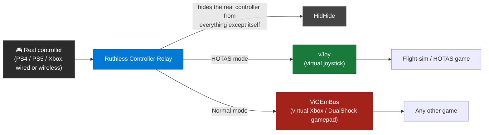

<div align="center">

# Ruthless Controller Relay

**Use a PlayStation or Xbox controller as a real HOTAS-style joystick — or a clean, reliable regular gamepad — in any Windows game.**

Full rumble, lightbar/LED color, and battery reporting, wherever the hardware and connection type genuinely allow it.

[](#)
[](src/hotas_relay.c)
[](https://ziglang.org/)
[](LICENSE)
[](../../releases/latest)

**[⬇️ Download the latest version](../../releases/latest)**

[Quick start](#quick-start) · [Controls](#controls) · [Head tracking](docs/HEAD_TRACKING.md) · [Updates](#updates) · [Coming next](#whats-coming-next) · [Compatibility](#what-works-and-what-doesnt) · [Is this safe?](#is-this-safe-to-run) · [Building](#building-from-source) · [Development story](docs/DEVELOPMENT_JOURNEY.md) · [Credits](#credits)

</div>

---

## New in v1.3.0

<p align="center"></p>

- **🎯 [Head tracking](docs/HEAD_TRACKING.md).** Turn your head and the camera follows, using any webcam. Press `H` in the relay window to set it up. Everything it needs comes in the download. Off until you turn it on.
- **A dot shows where you're pointing,** right in the relay window, with no extra windows.
- **`RB` does more:** tap to recenter; hold to look around with the stick, even behind you.
- **Automatic update check.** The relay tells you when there's a new version and asks before installing it. Press `C` to turn it off.

[Full changelog](CHANGELOG.md)

---

> **⚠️ On v1.0.0? Update to the [latest release](../../releases/latest).** In v1.0.0, if your controller turns off or falls asleep while the relay is running, the relay can lock onto its own virtual controller. Input stops, your real controller can become visible to the game, and the only fix is restarting both. The version is shown at the top of the relay window; v1.0.0 shows no number there. [What went wrong](docs/DEVELOPMENT_JOURNEY.md#a-sleeping-controller-made-the-relay-read-its-own-virtual-pad-fixed-in-v101) · [Changelog](CHANGELOG.md)

> **⚠️ Using Steam? Disable Steam Input for the game first** — it bypasses this software entirely otherwise. Details: [Known Limitations](docs/KNOWN_LIMITATIONS.md#steam-input-must-be-disabled).

---

## The problem this solves

Flight sims, space sims, and other HOTAS-style games bind their controls to a real **joystick** device — a flight stick, a throttle, a yoke. A gamepad isn't one of those, and Windows treats "gamepad" and "joystick" as genuinely different device classes, not just a labeling difference. If you don't own a real HOTAS setup and want to fly with a PS4/PS5 or Xbox controller instead, there was no clean, single tool that could present it as a virtual joystick to that one flight sim, while still behaving like a normal controller everywhere else — switchable live, with no reboot and no unplug/replug.

## How it works

This tool sits between your real controller and every game on the system:



Exactly one virtual device is ever "live" at a time — the other one is present but muted, never added or removed on the fly, since neither HidHide nor games handle live device changes reliably. Rumble, LED color, and battery level flow the other direction: read back from the virtual device and forwarded to the real controller, wherever the connection type allows it (see [compatibility](#what-works-and-what-doesnt) below).

<p align="center"></p>

<p align="center"><sub>The live dashboard — real-time axis/button state, current mode, and what the game sees vs. what's actually plugged in.</sub></p>

Three separate pieces of driver engineering make this possible — **[vJoy](https://github.com/shauleiz/vJoy)**, **[ViGEmBus](https://github.com/nefarius/ViGEmBus)**, and **[HidHide](https://github.com/nefarius/HidHide)** — all built and maintained by other people. See [Credits](#credits).

## Quick start

1. Download the [latest release](../../releases/latest) and unzip it, or [build it yourself](#building-from-source). The zip has everything: the relay, its drivers, and opentrack for head tracking.
2. **Using Steam?** [Disable Steam Input](docs/KNOWN_LIMITATIONS.md#steam-input-must-be-disabled) for the game first.
3. Run `RuthlessControllerRelay.exe`. On first run it self-installs vJoy/HidHide/ViGEmBus if they aren't already present (see [how and why](docs/DEVELOPMENT_JOURNEY.md#core-architecture)).
4. Connect a controller — the dashboard shows what it detected and what it's currently presenting to games.
5. Press `Ctrl+Alt+H` (or the controller-side combo shown on the dashboard) to switch between **HOTAS mode** and **Normal mode**.

For a plain-English "is this working right now" guide with no jargon, see the **[Compatibility Cheat Sheet (PDF)](docs/Controller_Compatibility_Cheat_Sheet.pdf)**.

### Controls

| Key | Does |
|---|---|
| `Ctrl+Alt+H` <br/><sub>(or the controller combo shown on-screen)</sub> | Switch between HOTAS mode and Normal mode |
| `V` | Flip the virtual output between PlayStation-style and Xbox-style |
| `R` | Change the hotkey/button combo for the mode switch above |
| `M` | Remap a button |
| `G` | Pick/launch a game |
| `F` | Free look: off, normal or head tracking |
| `H` | Set up [head tracking](docs/HEAD_TRACKING.md), or change its camera or game |
| `U` | Update, when the title line says a new version is out |
| `C` | Turn the automatic update check on or off |
| Hold `RB` <br/><sub>(HOTAS mode)</sub> | Free look: the right stick's left/right turns the camera. Let go and the view snaps back. See [Free look](#free-look-hotas-mode) |
| `RB` + click `R3` | Lock the camera where it's looking; tap `RB` or click `R3` to unlock |
| Tap `RB` <br/><sub>(head tracking)</sub> | Recenter. Hold it to steer with the stick instead. See [Head tracking](docs/HEAD_TRACKING.md#controls) |
| `+` / `-` | Free-look or head-tracking speed (saved automatically) |

### Free look (HOTAS mode)

New in v1.1.0. While you hold **RB** in HOTAS mode:
- the right stick's **left/right turns the camera** instead of rolling the aircraft,
- **up/down keeps flying pitch**, and the left stick works as normal, so you can keep making corrections while you look around,
- **letting go** snaps the camera back, and the stick flies again instantly, wherever it's pointing.

**Lock:** hold RB and click **R3** to keep the camera parked where it is after you let go. Tap **RB** or click **R3** to unlock. The dashboard banner turns yellow while you're looking and magenta while the camera is locked.

How it works: the relay holds **Left Alt** and turns the stick into **mouse movement**, which drives the game's own Alt + mouse free look. That only fits games where holding Left Alt and moving the mouse is free look. For any other game, set `freelook=off` in `ruthless_controller_relay.ini` and RB goes back to being an ordinary button. The speed lives in the same file as `freelook_speed=`, or change it live with `+` / `-`.

This is software-generated keyboard and mouse input, the same kind of stick-to-mouse remap DS4Windows and Steam Input do. Left Alt is always released when you let go, switch modes, disconnect, or close the relay, including after a crash.

**The controller-side default depends on what's plugged in the first time you ever run it**: a PlayStation controller defaults to the PS button alone, and an Xbox controller defaults to the **Guide/Xbox-logo button** — confirmed working on real hardware, including through the official Xbox Wireless Adapter dongle. Neither button ever reaches whatever the game sees, so it can't collide with anything the game itself does. This is decided once, the very first time a controller connects on a fresh install, and never overwritten afterward — change it any time with `R`, or by hand-editing `button=` in `ruthless_controller_relay.ini` (e.g. `button=back+start` for the classic combo instead). Full story, including why the newer Share button doesn't get the same treatment, in [Known Limitations](docs/KNOWN_LIMITATIONS.md#the-xboxguide-button--solved-and-confirmed-on-real-hardware).

Two separate Steam settings can each independently break this — see [Known Limitations](docs/KNOWN_LIMITATIONS.md#steam-input-must-be-disabled) if you use Steam.

When the PS button (or touchpad) is configured as the toggle specifically, it's deliberately never also forwarded as a normal vJoy button at the same time — so it can't do double duty as both a mode-switch and a bound joystick action. (This doesn't apply to standard buttons like Back+Start, which keep working as ordinary vJoy buttons even while also serving as the toggle combo — unchanged, long-standing behavior.)

### Head tracking (optional)

New in v1.3.0, off until you turn it on. Turn your head and the camera follows, with both hands still on the sticks. Press **`H`** in the relay window, pick your webcam and your game, and that's the whole setup. A dot in the relay window shows where you're pointing.

<p align="center"></p>

It only moves the mouse while you're in HOTAS mode and the game you picked has the mouse, so it leaves your desktop, other programs and in-game menus alone. The webcam is only on while head tracking is.

**Anti-cheat notice:** this sends your head movement to the game as software mouse movement, constantly, and some anti-cheat studies mouse input. No bans are known, but no one can promise that. Use it at your own risk.

Full guide, including other webcams and troubleshooting: **[docs/HEAD_TRACKING.md](docs/HEAD_TRACKING.md)**.

### Updates

The relay asks GitHub for the latest version number once each time it starts. If there's a newer one, the title line says so and **`U`** offers to install it. It always asks first, and it keeps your settings. Nothing is downloaded unless you say yes.

Don't want the check? Press **`C`**, or set `update_check=off` in `ruthless_controller_relay.ini`. The window shows whether it's on.

Versions before v1.3.0 can't do this, so grab this one [by hand](../../releases/latest). The SAFE build has no update check or head tracking.

### Stream Deck and macro-pad control (optional)

New in v1.2.0, off by default. Set `control_pipe=on` in `ruthless_controller_relay.ini` and a Stream Deck, any macro pad, or a script can switch HOTAS/Normal mode, flip the virtual pad between Xbox and PlayStation, switch free look (off, normal, head tracking), read the battery and live status, and close the relay. Unlike keyboard shortcuts, it keeps working while an administrator game has focus.

- **No plugin needed:** the included `RelayControl.exe` sends one command (`RelayControl.exe mode toggle`). Point a Stream Deck **System > Open** button at a shortcut to it.
- **Plugin authors:** it's a tiny local text protocol, one command per connection.

Local only, and the controller path isn't touched. Full guide: **[docs/STREAM_DECK.md](docs/STREAM_DECK.md)**.

Also in that guide: **[switching Discord's noise filter (Krisp) from a Stream Deck key](docs/STREAM_DECK.md#discords-noise-filter-from-a-stream-deck-vencord)**, with no window popping up. It's separate from the relay and uses the Vencord client mod, which is against Discord's terms, so it's strictly optional.

### Discord button in Normal mode (optional)

New in v1.2.0, off by default. Discord's keybinds can't see the virtual Xbox pad, so in Normal mode there was no controller button Discord could use for its mute. With `discord_button=dpad_down`, pressing D-pad down in Normal mode also presses an otherwise unused virtual-joystick button (button 18). Bind Discord's **Toggle Mute** to it, and a tap flips your mute while you play. HOTAS mode is unchanged. Setup and notes: **[docs/STREAM_DECK.md § Discord button](docs/STREAM_DECK.md#discord-button-in-normal-xbox-mode)**.

## What's coming next

Nothing scheduled right now. Ideas and requests are welcome in [Issues](../../issues).

Head tracking shipped in v1.3.0, Stream Deck control and the Normal-mode Discord button in v1.2.0, and free look in HOTAS mode in v1.1.0. See the [changelog](CHANGELOG.md).

## What works and what doesn't

Full plain-English matrix, connection by connection: **[Controller Compatibility Cheat Sheet (PDF)](docs/Controller_Compatibility_Cheat_Sheet.pdf)**.

| Controller | Connection | Input | Rumble / LED / Battery |
|---|---|:---:|:---:|
| PlayStation (DS4 / DualSense) | USB cable | ✅ | ✅ |
| PlayStation (DS4 / DualSense) | Bluetooth | ✅ | ❌ — [see why](docs/KNOWN_LIMITATIONS.md#bluetooth-playstation-controller-rumble-and-led-output) |
| Xbox | Wireless dongle | ✅ | ✅ |
| Xbox | USB cable | ✅ (normal play) | ⚠️ HOTAS mode unreliable — [see why](docs/KNOWN_LIMITATIONS.md#wired-xbox-controllers-cant-be-hidden-from-other-apps) |

Both limitations above are genuine Windows/hardware constraints, investigated in depth rather than assumed — the linked sections explain exactly why, and what was tried.

**HOTAS mode and force feedback:** flying with a HOTAS setup currently gets no vibration/force feedback from the sim itself — Normal-mode rumble (the row above) is unaffected either way. Real DualSense/DualShock HD-haptic force feedback is planned for a future release; see [issue #10](https://github.com/spongebobmoviept-lab/RuthlessControllerRelay/issues/10) for current status.

## Is this safe to run?

Yes, for the overwhelming majority of games and use cases — vJoy/ViGEmBus/HidHide are Microsoft-signed, widely used (the same foundation [DS4Windows](https://github.com/Ryochan7/DS4Windows) runs on), and this contains no keyboard/mouse interception of any kind. Free look and head tracking, both optional, do send software mouse movement to the game ([notice](docs/KNOWN_LIMITATIONS.md#free-look-and-head-tracking-send-software-input)). The one real, narrow exception is kernel-level anti-cheat in competitive multiplayer games, which can block driver-level tools like this regardless of intent — one confirmed case, not a general pattern. A full `--uninstall` is built in either way. Full detail, including exactly what's confirmed vs. uncertain: **[Known Limitations § Anti-cheat](docs/KNOWN_LIMITATIONS.md#anti-cheat)**.

## Building from source

Compile the resource file first (embeds the UAC manifest + icon):
```sh
zig rc resources/hotas_relay.rc resources/hotas_relay_manifest.res
```

Then build:
```sh
zig cc -target x86_64-windows-gnu -O2 -Wall -Wextra \
    -I third_party -I third_party/vigem_client \
    -o RuthlessControllerRelay.exe \
    src/hotas_relay.c resources/hotas_relay_manifest.res \
    -ldinput8 -ldxguid -lole32 -loleaut32 -lcomdlg32 -ladvapi32 -lshell32 -lsetupapi -lnewdev -lhid -lcfgmgr32 -lws2_32 -lwinhttp
```

`third_party/vigem_client/ViGEmClient.dll` and the contents of `third_party/drivers/` need to sit next to the built exe at runtime — see [docs/DEVELOPMENT_JOURNEY.md](docs/DEVELOPMENT_JOURNEY.md) for exactly why the driver payload is structured this way instead of shelling out to each vendor's own GUI installer.

`RelayControl.exe`, the small helper for Stream Deck buttons and scripts, is a separate program:
```sh
zig cc -target x86_64-windows-gnu -O2 -Wall -Wextra -Wl,--subsystem,windows -s \
    -o RelayControl.exe src/relay_control.c
```

Add `-DSAFE_MODE_NO_EXTRAS` to build a stripped-down fallback variant with no rumble/LED/battery code compiled in at all — a minimal, maximally conservative build for if the full one ever misbehaves on a specific machine.

Built and tested with **[zig cc](https://ziglang.org/)**, a self-contained cross-compiling C toolchain — no Visual Studio install required, even on the build machine.

<details>
<summary><b>Why does this need administrator rights?</b></summary>

<br>

The exe manages the lifecycle of a real kernel-mode virtual device (vJoy) that's created fresh on launch and fully torn down on exit, and it registers/hides devices through HidHide. Both need administrator rights on Windows, in both directions — it requests elevation on every launch, with no way around it. See [docs/DEVELOPMENT_JOURNEY.md § vJoy devices silently accumulating](docs/DEVELOPMENT_JOURNEY.md#vjoy-devices-silently-accumulating-across-sessions) for the actual trade-off this was weighed against (a persistent idle device vs. one UAC prompt per launch) and why it was decided this way.

</details>

## The development story

This project went through real, sometimes serious, failures on the way here — including one that briefly bricked a keyboard and mouse system-wide. Every one of them is written up in full, including the wrong turns, in **[docs/DEVELOPMENT_JOURNEY.md](docs/DEVELOPMENT_JOURNEY.md)** — not as a changelog, but as a guide so nobody building on this has to rediscover the same holes the hard way.

## Credits

This project is a thin layer of glue on top of the real engineering: three drivers and a head tracker, built and maintained by other people, doing all of the actual heavy lifting. None of this works without them.

| Project | Author | What it provides |
|---|---|---|
| **[vJoy](https://github.com/shauleiz/vJoy)** | Shaul Eizikovich | The virtual joystick device HOTAS mode is built on |
| **[ViGEmBus](https://github.com/nefarius/ViGEmBus)** / **[ViGEmClient](https://github.com/nefarius/ViGEmClient)** | Benjamin Höglinger-Stelzer ([Nefarius](https://nefarius.at/)) | Virtual Xbox/DualShock gamepad emulation |
| **[HidHide](https://github.com/nefarius/HidHide)** | Eric Korff de Gidts, Benjamin Höglinger-Stelzer (Nefarius) | Hides the real controller so games only ever see one device |
| **[opentrack](https://github.com/opentrack/opentrack)** | Stanislaw Halik and contributors | Reads your webcam for head tracking. Its unmodified installer is included in the release zip |

Full license texts and copyright notices for all of them are in **[THIRD_PARTY_LICENSES.md](THIRD_PARTY_LICENSES.md)** — please keep them intact if you redistribute this. This project is a small addition on top of a mountain of real driver-development work by the people above; they deserve the credit for what actually makes the hard parts possible.

This project's own code was developed with AI assistance for much of the implementation, debugging, and research, directed and hardware-tested throughout by the project owner.

## License

This project's own source code ([src/hotas_relay.c](src/hotas_relay.c) and everything else outside `third_party/` and `extras/`) is licensed under the [MIT License](LICENSE). The bundled third-party drivers and libraries under `third_party/` keep their own original licenses — see [THIRD_PARTY_LICENSES.md](THIRD_PARTY_LICENSES.md). The optional Vencord plugin in `extras/vencord-bridge/` builds into Vencord, so it's GPL-3.0-or-later like Vencord itself.
