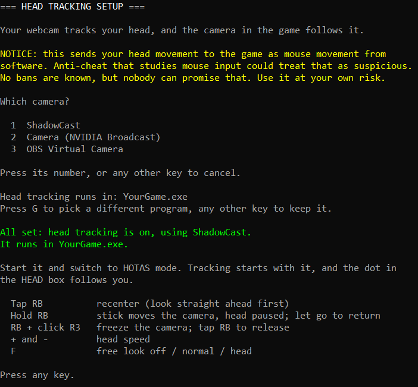
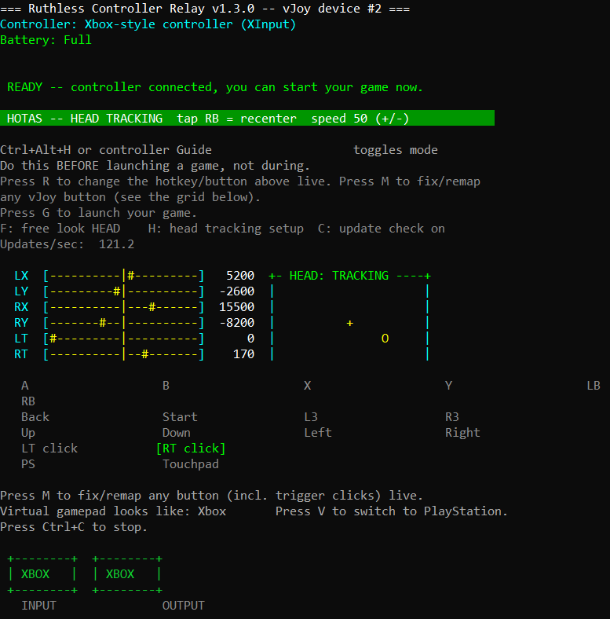

# Head tracking

Turn your head and the camera follows, with both hands still on the sticks. All you need is a webcam, and it's set up from inside the relay window. Added in v1.3.0, and off until you turn it on.

> **⚠️ Anti-cheat notice.** Head tracking sends your head movement to the game as **mouse movement from software**, constantly, while it's on. Some anti-cheat systems study how players use the mouse and keyboard, and could treat that as suspicious. One player using a head tracker has reported a ban for hacking, and the game studio's CEO said its detection may have seen it as inhuman mouse movement. There's no official rule or outcome yet, so nobody can promise it's safe. It's your account, so it's your call. [More about anti-cheat](KNOWN_LIMITATIONS.md#anti-cheat).

## What you need

- **A webcam** that can see your face. A phone or an HDMI camera works too, if Windows sees it as a camera.
- **Nothing else.** The tracker is built into the relay. Its engine and head model are in the `head_tracker` folder in the zip, so keep that folder next to the relay. There's nothing to install.
- **A game where holding Left Alt and moving the mouse is free look.** It's the same requirement as [free look](../README.md#free-look-hotas-mode).

## Setup

1. Start the relay and connect your controller.
2. Press **`H`** in the relay window.
3. Press the number of your camera.
4. Pick your game's `.exe` in the window that opens. If the relay already knows one, it shows you, and you can press **`G`** to pick a different one or any other key to keep it.
5. In your game's controls, bind free look reset, if it has one, to RB's joystick button. That's button 6, which some games show as button 5. Tapping RB presses it for a moment, and that's what recenters the camera. Without it, the HEAD box recenters but the camera may not.

That's it. Head tracking is now on. Tracking starts when the game starts, so you don't have to open anything else.

To try it, start your game, switch to **HOTAS mode** and turn your head. The **HEAD** box next to the stick bars shows a dot where you're pointing:

**Playing something else?** Head tracking only runs in the one program you picked, and it works in anything where Left Alt + mouse is free look. Press `H`, pick your camera, then press `G` and pick the other game's `.exe`.

## Controls

On a PlayStation controller, `RB` is `R1`.

| Control | Does |
|---|---|
| `F` | Free look: **off**, **normal** or **head**. The webcam is only on in head |
| Tap `RB` | Recenter. Look straight ahead first, because wherever your head is becomes straight ahead |
| Hold `RB` | Head tracking pauses and the right stick's left/right turns the camera, so you can look behind you. Up/down keeps flying |
| Let go of `RB` | The camera goes back to where your head has it, with the center unchanged |
| Hold `RB` + click `R3` | Freeze the camera where it is. Tap `RB` to release and recenter |
| `+` / `-` | Head speed (saved automatically) |
| `H` | Run setup again, to switch cameras or games |

Head tracking only runs in **HOTAS mode**. In Normal mode the camera turns off, and comes back when you switch to HOTAS mode.

## What the HEAD box says

| Word | Meaning |
|---|---|
| **OFF** | Head tracking is off, or you're in Normal mode. In Normal mode, switch to HOTAS mode. If the dashboard doesn't say `free look HEAD`, press `F` |
| **WAITING** | Head tracking is on, but it isn't reading a head yet. Normal until your game is running. The camera takes a moment to start, and tracking begins once it sees your face. If it stays this way, see below |
| **TRACKING** | Your head is moving the camera |
| **PAUSED** | The game you picked doesn't have the mouse right now: you're in a menu, in another program, or your cursor is on another monitor. It comes back by itself |
| **RB: STICK** | You're holding RB, so the stick has the camera |
| **LOCKED** | The camera is frozen with RB + R3 |

## Your mouse is safe

Head tracking only moves the mouse while **all** of these are true:
- you're in HOTAS mode,
- the program you picked in setup has focus,
- your cursor is over it,
- the game has hidden the cursor, which it does while you're flying but not in menus.

So it stays out of your way on your desktop, on another monitor and in menus like an inventory.

## If something's off

| Problem | Try |
|---|---|
| Stuck on **WAITING** with the game running | Face the camera, because tracking starts when it first sees your face. Check that the `head_tracker` folder is next to the relay. Press `H` and check the camera and program. Make sure no other program is using the camera: a camera can usually only be used by one program at a time. A virtual camera also needs its own app running |
| Stuck on **PAUSED** while you're playing | Setup may have the wrong `.exe`. Some games start from a launcher and then run as a different program, which Task Manager's Details tab shows while you play. Press `H`, then `G` and pick that one. In Unreal Engine games it usually ends in `-Win64-Shipping.exe`. A game that keeps the mouse cursor showing while you play stays on PAUSED too |
| **TRACKING**, but the camera doesn't move | Check your game's free look setting. It was tested with vehicle free look set to on by default. Also check that Left Alt + mouse is free look in your game |
| Up/down is backwards | Set `head_pitch=-1` in `ruthless_controller_relay.ini` (close the relay first) |
| Left/right is backwards | Set `head_yaw=-1` the same way |
| Too fast or too slow | `+` and `-` in the relay window |
| Small shakes | Raise `head_deadzone`, or lower the speed with `-` |
| Feels delayed or stutters | Close anything heavy that's running while you play. Compiling code during a test made tracking noticeably worse. Better light and a higher frame rate camera also help |
| Keyboard shortcuts act strange in the game | While the game has the mouse, the relay holds Left Alt, so shortcuts see Alt held. F4 can close the game, for example. Stream Deck keys and the like are unaffected if they don't send keystrokes |
| In a chase view, the camera stays pointing one way while the vehicle turns | Some games lock free look to a compass direction in outside views. Tap `RB` to recenter, or use head tracking in the cockpit view, where it stays with the vehicle |

## Settings

These live in `ruthless_controller_relay.ini`, next to the relay. Close the relay before editing.

| Setting | Does | Default |
|---|---|---|
| `freelook` | `off`, `on` or `head` | `on` |
| `head_speed` | Mouse movement per degree of head turn | `50` |
| `head_yaw` | Multiplies left/right. `0` turns it off, negative flips it | `1.00` |
| `head_pitch` | Multiplies up/down. `0` turns it off, negative flips it | `1.00` |
| `head_deadzone` | Head wobble smaller than this many degrees is ignored | `0.15` |
| `game_path` | The program head tracking runs in. Set it with `H` | none |
| `head_camera` | The camera to use. Set it with `H` | none |
| `head_width`, `head_height`, `head_fps` | The video mode to ask the camera for, or the closest it has | `640`, `480`, `60` |

## Cameras

Anything Windows offers as a camera works, virtual ones like OBS Virtual Camera and NVIDIA Broadcast included. A virtual camera only delivers video while its own app is running. If a camera stops sending video, tracking stops, and the relay tries it again every 10 seconds.

The tracker shrinks a larger picture to at most 640 wide before reading it, so a higher resolution doesn't make tracking sharper.

The tracker uses real CPU while it runs: about 1.6 cores for the whole relay in testing on an 8-core desktop CPU. The camera is off with no game running, in Normal mode, and in `off` or `normal`.

## How it works

Your webcam goes to a tracker inside the relay, which works out where your head is pointing. The picture stays inside the relay and is never saved or sent anywhere. The relay turns your head movement into mouse movement while Left Alt is held, the same route as [free look](../README.md#free-look-hotas-mode). The tracker runs on its own threads, so the path from your controller to the game isn't touched. If you close the relay, the camera closes with it and Left Alt is released. The method is opentrack's, ported to C: see [Credits](../README.md#credits).

## Removing it

Set free look to off or normal with `F`, and nothing runs.

Nothing was ever installed, and nothing goes in the registry or your Documents. Delete the `head_tracker` folder and head tracking is gone.
